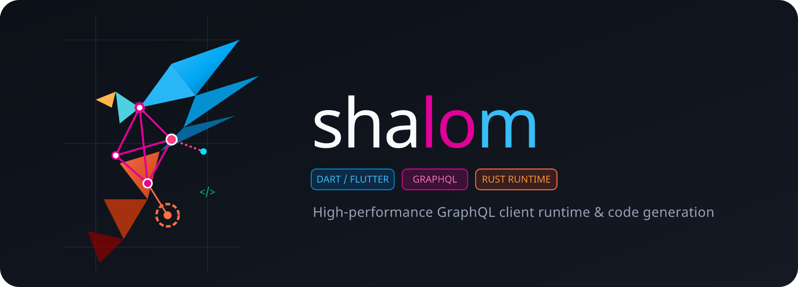

  
  <h1 class="hero-title">Declarative GraphQL for Flutter & Dart</h1>
  

    Backed by a high-performance Rust runtime with normalized caching, optimistic updates, and reactive entity-level subscriptions.
  

  

    <a href="overview/" class="hero-btn hero-btn-primary">Get Started &rarr;</a>
    <a href="quickstart/" class="hero-btn hero-btn-secondary">View Quickstart</a>
  

  

    
⚡

    <h3>Rust-Powered Core</h3>
    
A full-fledged GraphQL runtime written in Rust handles normalized caching, link execution, GC, and optimistic mutations with zero UI-thread overhead.

  

  

    
🪄

    <h3>Declarative Codegen</h3>
    
Annotate your Flutter widgets with <code>@Query</code>, <code>@Mutation</code>, and <code>@Fragment</code>. No manual glue, no separate <code>.graphql</code> operation files.

  

  

    
🎯

    <h3>Reactive Scopes</h3>
    
Generated fragment <code>Ref</code> and <code>Scope</code> types keep individual list items and widgets in sync without global state management solutions.

  

